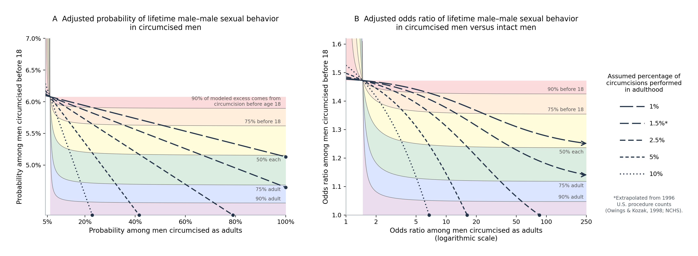
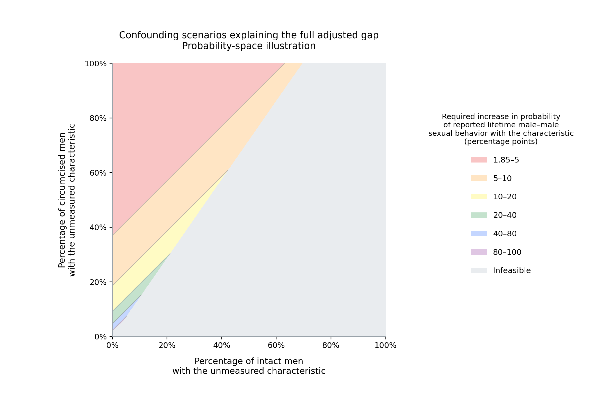

# Selected sensitivity figures

These are the two selected NHANES figures for manuscript development. The PNG, PDF and SVG files preserve the approved appearance; explanatory text is kept outside the images. No participant data or model-draw files are included.

The pooled 1999–2016 primary frequentist model gives OR 1.472262 (95% CI 1.151797–1.881889), p = 0.002271. Standardizing to the survey-weighted circumcised complete-case covariate distribution (n = 9,167) gives intact-reference probability 4.225805%, circumcised probability 6.079274%, and gap 1.853469 percentage points. Both figures use these same fitted coefficients and targets. They show point scenarios, without scenario confidence intervals.

## 1. Circumcision timing



[PDF](timing.pdf) · [SVG](timing.svg) · [PNG](timing.png) · [Plotting code](../analyses/figures/timing_plot.py)

The left panel shows component-weighted adjusted probabilities; the right shows common conditional ORs relative to intact men. Dashed curves distinguish assumed adult shares of currently circumcised men. Colored bands and gray boundaries distinguish the share of the modeled excess assigned to each timing group. Before age 18 includes infancy, childhood and adolescence; it does not establish timing before sexual development.

For each covariate pattern x, the construction solves pC(x) = (1-f(x)) pEarly(x) + f(x) pAdult(x), with the survey-weighted mean of f(x) fixed to the assumed adult share. Timing-specific conditional ORs are constant over x, while timing shares can vary. Component probabilities are averaged over their constructed component distributions. The displayed region assumes both component ORs are at least 1; it does not show every possible protective/positive combination. Panel A is cropped and panel B stops at adult OR 250; endpoints and arrows indicate bounds or continuation.

The 1.5% asterisk is a historical procedure-count extrapolation, not an observed lifetime share, a hard upper bound, or a statistically established most-likely value. Its source is Owings and Kozak (1998), *Ambulatory and Inpatient Procedures in the United States, 1996*, NCHS Series 13 No. 139, Table 11. See the [source audit](../analyses/timing/sources.md#s07--owings-and-kozak-1998-nchs-series-13-no-139), [numerical assumptions](../analyses/timing/source_values.json), and [timing methods](../analyses/timing/methods.md).

Computation: [OR curves](../analyses/figures/timing_or_curves.py), [probability curves](../analyses/figures/timing_probability_curves.py), and the shared [endpoint solver](../analyses/timing/endpoints.py). Timing is unobserved in NHANES. These compatible associations do not identify age-specific causal effects.

## 2. Unmeasured confounding in probability space



[PDF](confounding.pdf) · [SVG](confounding.svg) · [PNG](confounding.png) · [Calculation and plotting code](../analyses/figures/confounding_plot.py)

The axes give the prevalence of a hypothetical binary characteristic among intact and circumcised men. Bands show the required difference in behavioral probability between men with and without that characteristic, in percentage points. Gray combinations are infeasible under this model.

Writing qI and qC for characteristic prevalences and a and b for outcome probabilities without and with the characteristic, respectively, the model assumes pI = a + qI(b-a) and pC = a + qC(b-a). Thus b-a = (pC-pI)/(qC-qI), a = pI-qI(b-a), and b = a+(b-a). The code checks that both probabilities lie in [0,1] and that each feasible combination reconstructs both targets. The display orients the characteristic as more prevalent in circumcised men and associated with higher outcome probability; its complement reverses both directions.

This is a marginal binary-mixture illustration with common outcome probabilities across circumcision groups, assigning the full gap to the characteristic. It is not a fitted religion model, a general bound on all sources of bias, or evidence that confounding has been excluded. No probabilities are assigned to the scenarios.

## Reproduce

From the repository root, using the installed requirements:

```sh
python scripts/reproduce.py
python -m analyses.figures.reproduce
```

The second command reuses the fitted model; it does not refit a new outcome model. It checks the input-data hash, reconstructs mixtures and verifies feasible probabilities. Generated images and numerical checks remain under `outputs/selected_figures/`. It does not overwrite the selected copies in this directory. The source data and fitted participant-level standardization inputs remain local.

For the manuscript's underlying association, use the [frequentist results](../docs/results.md), [methods](../docs/methods.md), and [validation](../docs/validation.md) alongside these figures.
